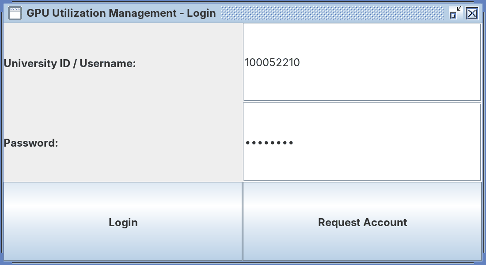
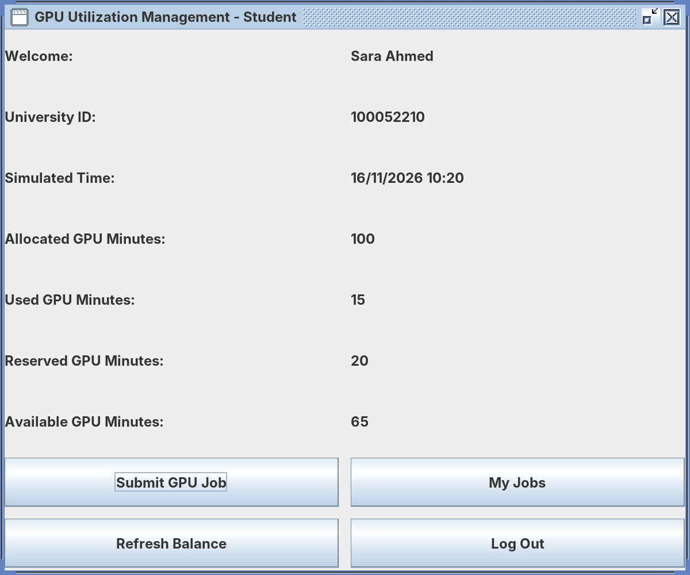
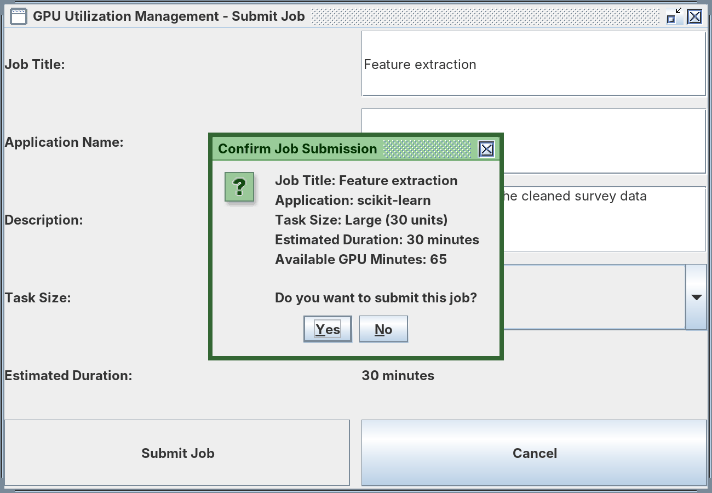
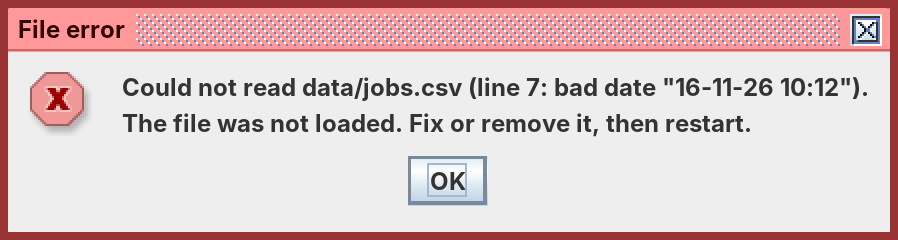
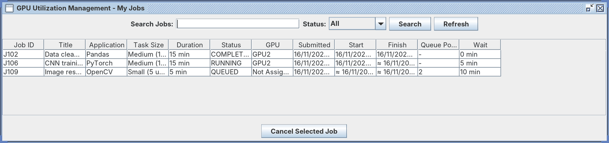
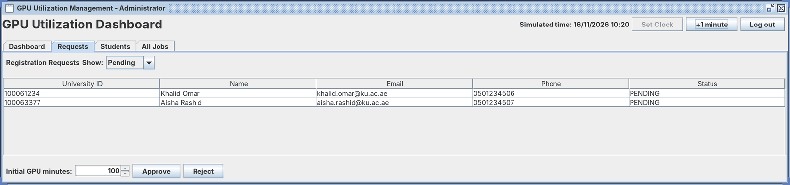
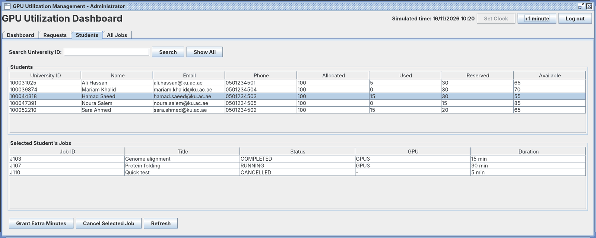
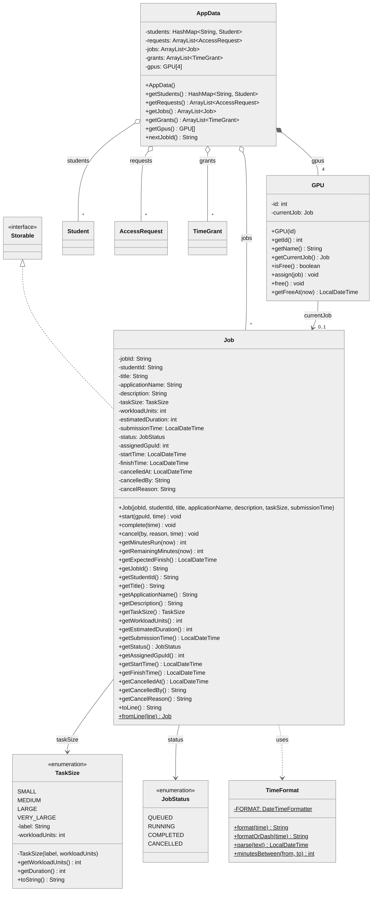
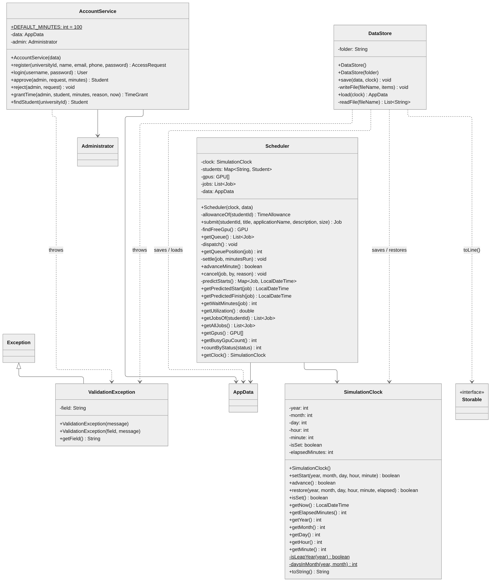
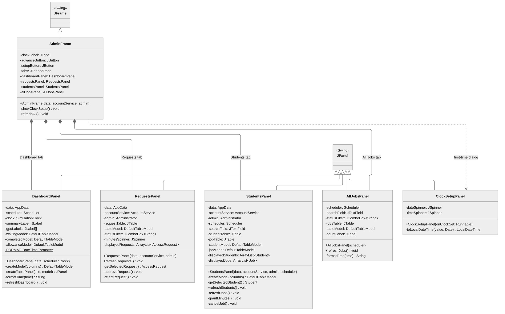

# GPU Utilization Management System

COSC 230 Object-Oriented Programming lab project, Fall 2026, Khalifa University.

A Java Swing desktop app that manages four shared NVIDIA H100 GPUs for students. Students register, the administrator approves them and gives them GPU minutes, and students submit jobs that are scheduled on the GPUs. The GPUs and the clock are simulated.

| Member | Student ID | GitHub | Part |
|---|---|---|---|
| Simreen Siraj Shehzadi | 100068862 | [simreensiraj](https://github.com/simreensiraj) | A: model classes, accounts, file storage, `Main`, tests |
| Mariam Alzaabi | 100066146 | [mariamalzaabii](https://github.com/mariamalzaabii) | B: simulation clock, scheduler |
| Alyazeya Alhammadi | 100060361 | [alhammadi-007](https://github.com/alhammadi-007) | C: login, registration, student screens |
| Maryam Alhefeiti | 100060410 | [mksalhefeiti](https://github.com/mksalhefeiti) | D: admin screens, demo data |


## Contents

- [The task](#the-task)
- [What the app does](#what-the-app-does)
- [How to run it](#how-to-run-it)
- [Design](#design)
- [Testing and results](#testing-and-results)
- [Version control](#version-control)
- [Limitations](#limitations)
- [Repository layout](#repository-layout)

## The task

The project asks for a Java OOP app with a JFrame interface that:

- lets students register with university ID, name, email, phone and a password
- lets the fixed administrator (`admin` / `gpu2026`) approve or reject them; approval gives 100 GPU minutes by default
- lets approved students submit jobs within their allowance, choosing one of four sizes
- runs the jobs first come, first served on four GPUs, lowest free GPU ID first
- moves time only when the administrator presses **+1 minute**
- shows queue positions, predicted start and finish times, waits and utilization
- saves everything to files and restores it on restart
- uses encapsulation, inheritance, interfaces, polymorphism and collections, and keeps the GUI separate from the logic

| Size | Workload units | Duration |
|---|---|---|
| Small | 5 | 5 min |
| Medium | 15 | 15 min |
| Large | 30 | 30 min |
| Very large | 60 | 60 min |

The allowance rule is **available = allocated − used − reserved**. A job's full duration is reserved when it is accepted. When it completes, or is cancelled while running, the reservation is released and only the minutes it actually ran are charged. A job cancelled while queued costs nothing.

## What the app does

**Students**
- request an account, then log in with their university ID
- see allocated, used, reserved and available minutes
- submit a job (title, application, description, size) after confirming the duration
- see their own jobs with status, GPU, start and finish times (predicted ones marked `≈`), queue position and wait
- search and filter their jobs, and cancel a queued or running job with a reason

**Administrator**
- sets the clock once with date and time spinners, then moves it with **+1 minute**
- approves requests with an initial number of minutes, or rejects them
- sees a dashboard: job counts, busy GPUs, utilization, each GPU's job and finish time, waiting jobs, completed jobs and every balance
- searches students by ID, grants extra minutes with a reason, cancels any queued or running job with a reason
- lists every job with a search box and a status filter

<details>
<summary><b>Screenshots</b> (taken on the 10:20 data from the test scenario)</summary>

| | |
|---|---|
|  |  |
| Login | Registration with an invalid email |
|  |  |
| Student home: 100 / 15 / 20 / 65 | Confirming a Large job |
|  |  |
| 60 minutes asked, 55 available: refused | Broken `jobs.csv`: file and line named |


*Sara's jobs at 10:20: J109 is second in the queue and waits 10 minutes.*


*First admin login on empty data: the clock must be set first.*





</details>

## How to run it

You need Java 17 or newer. There are no external libraries.

**Open the project**
- Eclipse: File → Import → General → Existing Projects into Workspace → choose this folder.
- VS Code: install the Extension Pack for Java, then File → Open Folder.

**Run**

| File | What it does |
|---|---|
| `src/ui/Main.java` | Starts the app with the data in `data/`. On the first run log in as `admin` / `gpu2026` and set the clock. |
| `src/ui/DemoMain.java` | Starts the app with the demo data in `demo-data/`. |
| `src/ui/DemoDataGenerator.java` | Rebuilds `demo-data/`. Close the app first, it overwrites the demo files. |
| `test/tests/ModelStorageTest.java` | Tests the model classes and storage (29 checks). |
| `test/tests/ScenarioTest.java` | Replays the guide's 10:20 example and tests the rules (45 checks). |

**Demo logins** (in `DemoMain`): `admin` / `gpu2026`, or students `100011` to `100015` with password `Demo12345`. The demo has 5 approved students, 2 pending and 1 rejected request, and 20 jobs: 6 completed, 6 cancelled, 4 running and 4 queued.

To start again from nothing, close the app and delete the `data/` folder.

## Design

The code is split into four packages. Only `ui` uses Swing.

| Package | Classes | Job |
|---|---|---|
| `model` | `User`, `Student`, `Administrator`, `AccessRequest`, `Job`, `GPU`, `TimeAllowance`, `TimeGrant`, `AppData`, `Storable`, `TimeFormat`, `TaskSize`, `JobStatus`, `RequestStatus` | The data and the rules that protect it |
| `logic` | `AccountService`, `Scheduler`, `SimulationClock`, `ValidationException` | Accounts, scheduling, the clock |
| `storage` | `DataStore` | Saves and loads the CSV files |
| `ui` | `Main`, `DemoMain`, `DemoDataGenerator`, `LoginFrame`, `StudentRegistrationFrame`, `StudentFrame`, `SubmitJobFrame`, `MyJobsFrame`, `MyJobsPanel`, `AdminFrame`, `DashboardPanel`, `RequestsPanel`, `StudentsPanel`, `AllJobsPanel`, `ClockSetupPanel` | The windows |


`Main` creates one `AppData`, `SimulationClock`, `AccountService` and `Scheduler` and passes them to every window, so all screens work on the same data.

**How the classes connect**
- **Submit a job:** `SubmitJobFrame` → `Scheduler.submit()` reserves the minutes on the student's `TimeAllowance` (throws if there isn't enough), creates the `Job`, adds it to `AppData` and dispatches queued jobs onto free GPUs.
- **+1 minute:** `AdminFrame` → `Scheduler.advanceMinute()` moves the `SimulationClock`, completes finished jobs, settles them (release + charge), frees their GPUs and starts waiting jobs. Then `Main.save()` writes the files.
- **Cancel:** `MyJobsPanel` (owner) or `StudentsPanel` (admin) → `Scheduler.cancel()`. A running job is charged the minutes it ran and frees its GPU; a queued job is released for free.
- **Start and exit:** `Main` → `DataStore.load()` restores everything and puts running jobs back on their GPUs; a shutdown hook calls `DataStore.save()`.

**Predictions** copy each GPU's free-at time and give the queued jobs, in FCFS order, to the earliest copy (ties go to the lower GPU ID). The real GPUs are never changed. **Utilization** is the minutes run by all jobs ÷ (4 × minutes since the clock was set), shown as N/A at time zero.

**The five OOP mechanisms**

| Mechanism | Where |
|---|---|
| Encapsulation | `TimeAllowance` keeps allocated, used and reserved private; only `reserve()`, `release()`, `charge()` and `grant()` change them and none can go negative. `User` hides the password behind `checkPassword()`. |
| Inheritance | `Student` and `Administrator` extend the abstract `User`. The windows extend `JFrame` / `JPanel`. |
| Interfaces | `Student`, `AccessRequest`, `Job` and `TimeGrant` implement `Storable` (`toLine()`). |
| Polymorphism | `AccountService.login()` loops over a list of `User` and calls `checkPassword()`; `DataStore` calls `toLine()` on any `Storable`. |
| Collections | `HashMap` of students, `ArrayList`s of requests, jobs and grants, `GPU[4]`, `List<Job>` queue, `Map<Job, LocalDateTime>` predictions. |

**Storage.** `DataStore` writes `students.csv`, `requests.csv`, `jobs.csv`, `grants.csv` and `clock.csv`, one object per line. A missing file means nothing was saved yet. A broken line stops loading with a message naming the file and line, and the file is not overwritten.

```
students.csv  100052210,gpu12345,Sara Ahmed,sara.ahmed@ku.ac.ae,0501234502,100,15,20
jobs.csv      J106,100052210,CNN training,PyTorch,Train the image classifier,MEDIUM,16/11/2026 10:10,RUNNING,2,16/11/2026 10:15,,,,
clock.csv     2026,11,16,10,20,20
```

<details>
<summary><b>Class diagrams</b> (every attribute and method)</summary>

**Model: users, requests, allowances, grants**


**Model: jobs, GPUs, AppData**


**Logic and storage**


**UI: Main, login, registration, student windows**


**UI: administrator window and tabs**


</details>

## Testing and results

Both tests are plain `main` methods that print `PASS` or `FAIL` for each check and end with `ALL PASSED`. Run them with *Run As → Java Application*.

| Test | Checks | Result |
|---|---|---|
| `ModelStorageTest`: allowance rules, illegal job moves, accounts, save and reload, missing and broken files | 29 | all pass |
| `ScenarioTest`: the guide's 10:20 example through the real `Scheduler` and `AccountService`, then predictions, cancellations, limits and every login and registration message | 45 | all pass |

The scenario sets the clock to 16/11/2026 10:00, approves five students with 100 minutes each, and submits J101 to J110 at the times in the guide while pressing +1 minute (J110 is cancelled by its owner while queued). At 10:20:

| Check | Guide | Our app |
|---|---|---|
| GPU1 / GPU2 / GPU3 / GPU4 | J105 / J106 / J107 / J104 | J105 / J106 / J107 / J104 |
| Finish times | 10:38 / 10:30 / 10:45 / 10:30 | 10:38 / 10:30 / 10:45 / 10:30 |
| J108, J109 waits | 10, 10 min | 10, 10 min |
| Utilization | 96.3% | 96.3% |
| Ali / Sara / Hamad (alloc/used/res/avail) | 100/5/30/65, 100/15/20/65, 100/15/30/55 | same |
| J110 charge | 0 | 0 |
| Waits after J111 (Large) is submitted | 10 / 10 / 15 | 10 / 10 / 15 |
| Waits after +1 minute | 9 / 9 / 14 | 9 / 9 / 14 |

After saving and reloading, the clock, running jobs, remaining times, waits and balances come back the same.

## Version control

Everything is in one repository on the `main` branch. Each member committed from their own account as their part was built. The model went in first (13–15 Nov) so the scheduler and screens could build on it; the scheduler and the screens were connected on 19 Nov; the admin tabs, demo data and documentation followed on 20–21 Nov.


| Member | Commits | Main work |
|---|---|---|
| Simreen | 32 | project setup, every model class one commit at a time, `AccountService`, `DataStore`, tests, `Main`, diagrams |
| Mariam | 16 | `SimulationClock`, `Scheduler` step by step, moving it onto the shared `AppData` |
| Alyazeya | 21 | login, registration, student home, job form, My Jobs, connecting them to the services |
| Maryam | 9 | admin window and all tabs, clock setup, demo data and demo mode |

*Counts are up to 21 Nov 2026 and leave out merge commits. Some members committed whole screens at once, so the counts don't show how big each commit was.*

## Limitations

- Admin actions save straight away. Registrations, approvals, rejections and student submissions and cancellations are saved when the app closes, so a force-quit loses them.
- Passwords are stored as plain text in the CSV files.
- One fixed admin account and one user at a time on one computer, as the task describes.
- Student windows refresh when they come to the front or when *Refresh* is pressed, not on a timer.
- The clock's year spinner shows `2,026`, and some table columns cut off long values unless the window is widened.
- Time moves in whole minutes and only the four task sizes exist. No real GPU work happens.

## Repository layout

```
src/
  model/      User, Student, Administrator, AccessRequest, Job, GPU, TimeAllowance,
              TimeGrant, AppData, Storable, TimeFormat, TaskSize, JobStatus, RequestStatus
  logic/      AccountService, Scheduler, SimulationClock, ValidationException
  storage/    DataStore
  ui/         Main, DemoMain, DemoDataGenerator and the Swing windows
test/tests/   ModelStorageTest, ScenarioTest
demo-data/    demo students, requests, jobs and clock
docs/         class diagrams, screenshots, commit chart
.project, .classpath, .settings/   Eclipse project files
LICENSE
```
