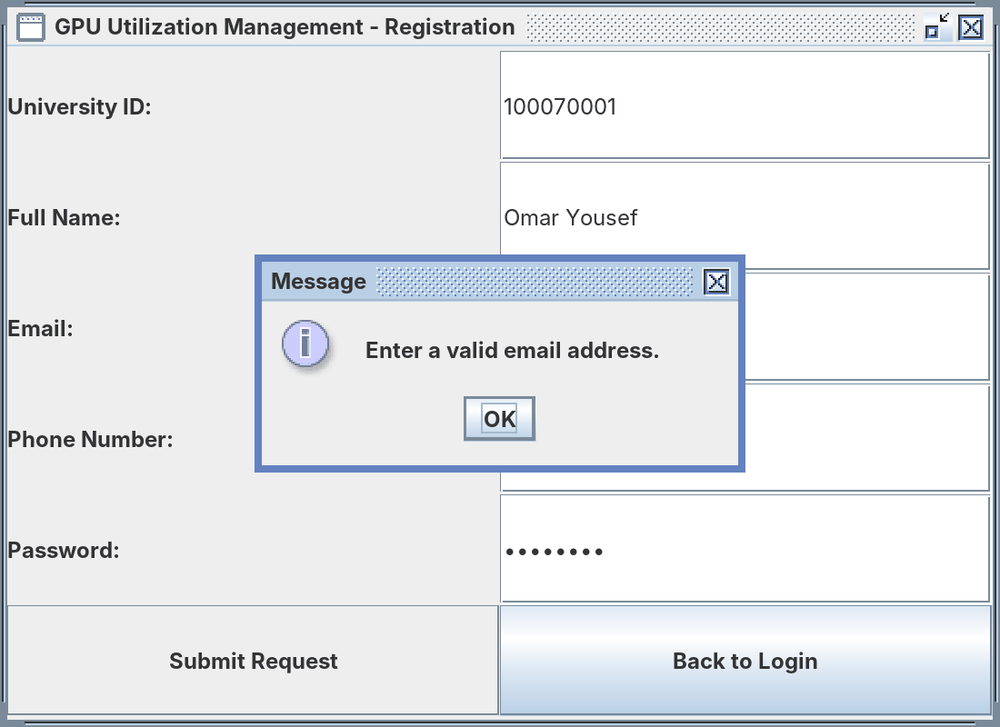
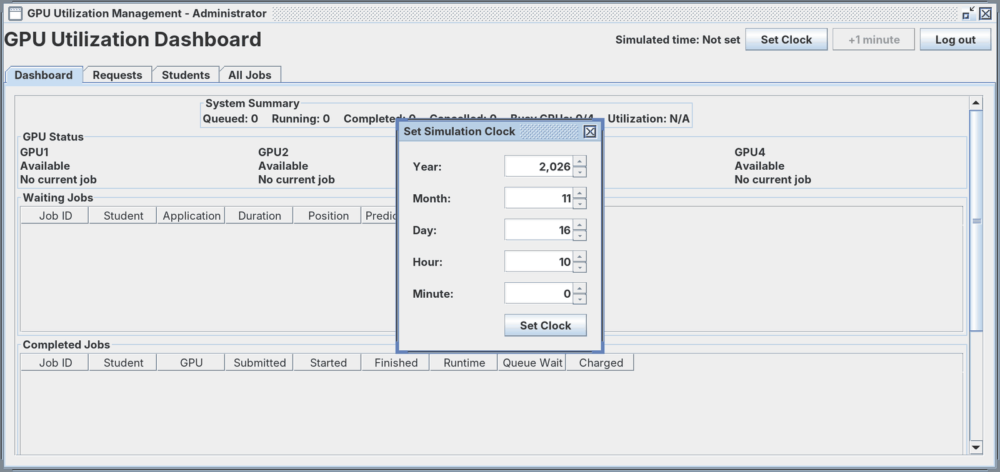
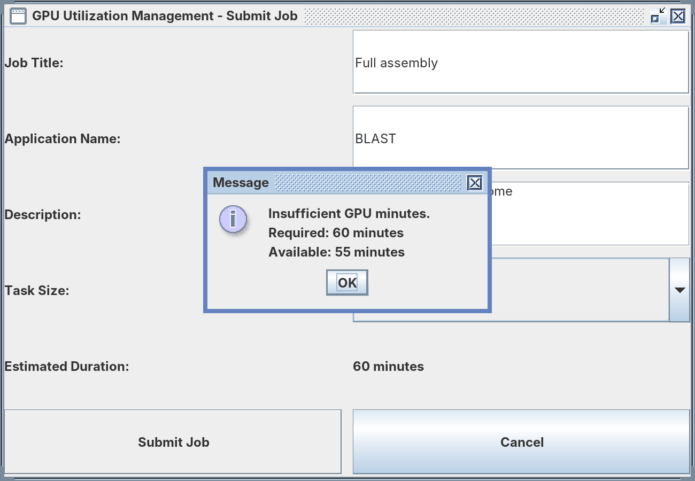
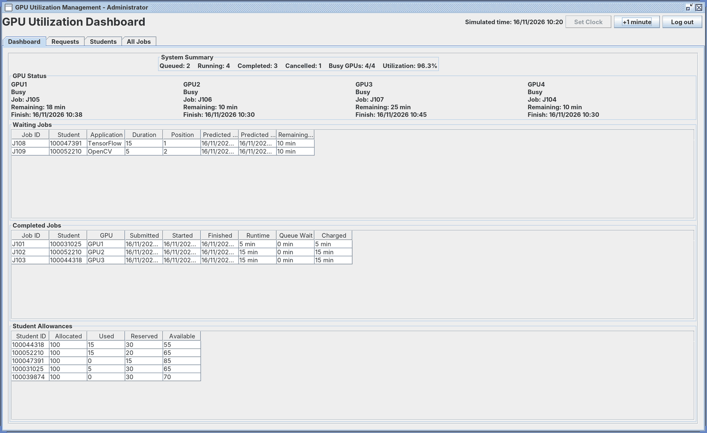
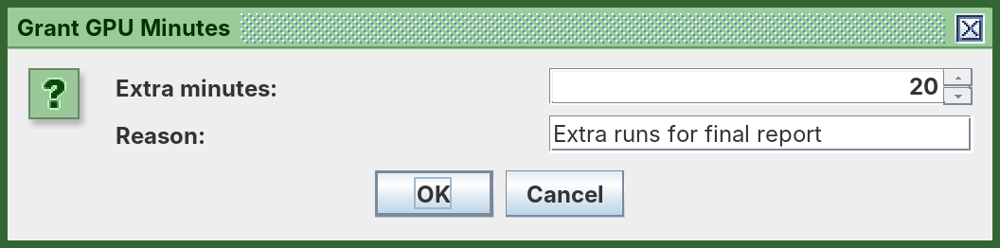
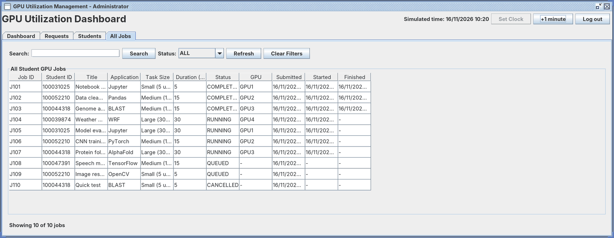
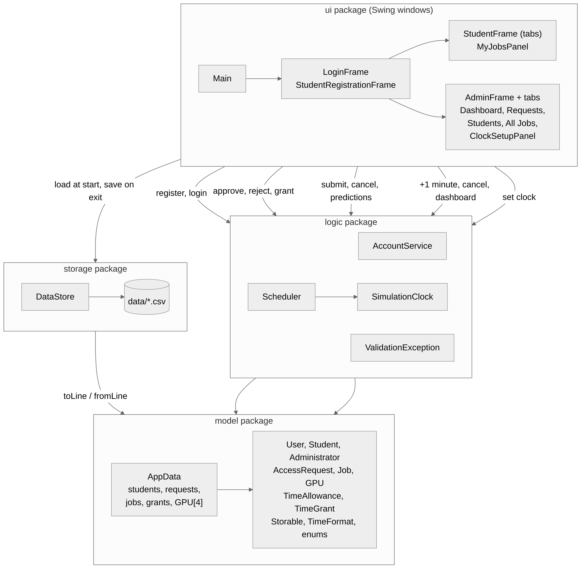
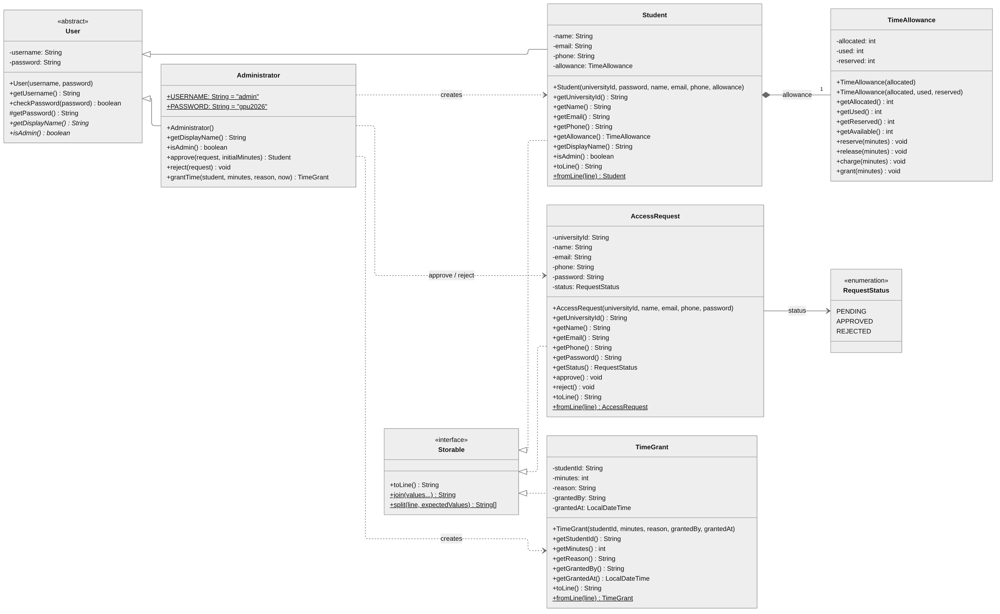
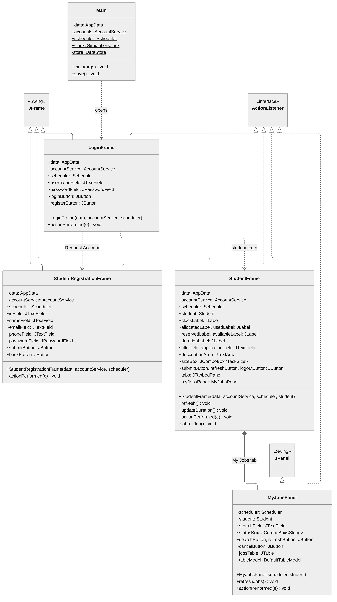
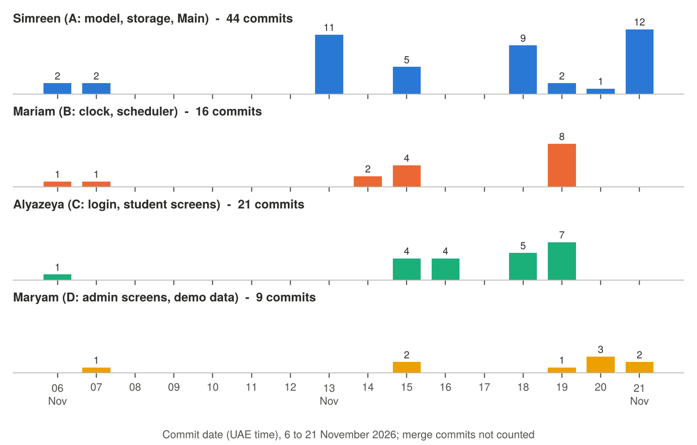

# GPU Utilization Management System

COSC 230 Object-Oriented Programming lab project, Fall 2026, Khalifa University.

A Java Swing desktop app that shares four NVIDIA H100 GPUs between students. Students ask for an account, the administrator approves them and gives them GPU minutes, and students submit jobs that run on the GPUs one after another. Nothing really runs on a GPU: the GPUs and the clock are simulated, and time only moves when the administrator presses **+1 minute**.

| Member | Student ID | GitHub | Part |
|---|---|---|---|
| Simreen Siraj Shehzadi | 100068862 | [simreensiraj](https://github.com/simreensiraj) | A: model classes, accounts, file storage, `Main`, tests |
| Mariam Alzaabi | 100066146 | [mariamalzaabii](https://github.com/mariamalzaabii) | B: simulation clock, scheduler |
| Alyazeya Alhammadi | 100060361 | [alhammadi-007](https://github.com/alhammadi-007) | C: login, registration, student screens |
| Maryam Alhefeiti | 100060410 | [mksalhefeiti](https://github.com/mksalhefeiti) | D: admin screens, demo data |

**Contents:** [The task](#the-task) · [How it works, step by step](#how-it-works-step-by-step) · [Class diagrams](#class-diagrams) · [How to run it](#how-to-run-it) · [Testing and results](#testing-and-results) · [Version control](#version-control) · [Limitations](#limitations) · [Repository layout](#repository-layout)

## The task

Build a Java OOP app with a JFrame interface where:

- students register with their university ID, name, email, phone and a password
- one fixed administrator (`admin` / `gpu2026`) approves or rejects them; approval gives 100 GPU minutes by default
- approved students submit jobs within their minutes, choosing one of four sizes
- jobs run first come, first served on four GPUs, on the lowest free GPU ID
- time moves only with **+1 minute**, and the app shows queue positions, predicted times, waits and utilization
- everything is saved to files and comes back after a restart
- the code uses encapsulation, inheritance, interfaces, polymorphism and collections, and keeps the GUI separate from the logic

| Size | Workload units | Duration |
|---|---|---|
| Small | 5 | 5 min |
| Medium | 15 | 15 min |
| Large | 30 | 30 min |
| Very large | 60 | 60 min |

## How it works, step by step

The screenshots follow the example in the project guide: the clock was set to 16/11/2026 10:00, five students got 100 minutes each, and ten jobs (J101 to J110) were submitted between 10:00 and 10:19. The screenshots are at 10:20.

### 1. Start the app

`Main` loads the saved files from `data/` with `DataStore`, creates one `AppData`, `SimulationClock`, `AccountService` and `Scheduler`, and opens the login window. Every window gets these same objects, so all screens show the same data. Students sign in with their university ID; the administrator signs in as `admin`.


### 2. A student asks for an account

The registration form has only the five fields from the task. `AccountService.register()` checks them (nothing empty, a valid email and phone, the ID not already used) and saves an `AccessRequest` with status *Pending*. Until it is approved, signing in shows "Your registration request is still pending approval."



### 3. The administrator sets the clock (first time only)

On the first admin login there is no saved clock, so the clock setup opens with a date picker and a time picker. After that the clock only moves with **+1 minute** and never follows the computer's clock. Until it is set, jobs can't be submitted and +1 minute is disabled.



### 4. The administrator approves the request

The Requests tab lists the requests. **Approve** creates a `Student` with a `TimeAllowance` of 100 minutes (the administrator can change the number first). **Reject** only changes the status. A request can't be processed twice.


### 5. The student signs in and sees their minutes

The student window has two tabs, like the guide's mockup: **Home and Submit** and **My Jobs**. The top of the Home tab shows the student's minutes. Every student has a `TimeAllowance` with three numbers, and **available = allocated − used − reserved**. *Reserved* is time held for jobs that are queued or running; *used* is time that jobs actually ran. Here Sara has 100 allocated, 15 used, 20 reserved, so 65 available.


### 6. The student submits a job

Under the minutes, the student types a title, application and description and picks a size. The duration comes from the size, and the student confirms it. `Scheduler.submit()` first reserves the minutes; if the job needs more than the available time it is refused and nothing is saved (an exact match is accepted).

| Confirming a Large job | Not enough time: 60 asked, 55 available |
|---|---|
|  |  |

### 7. The scheduler puts the job on a GPU or in the queue

If a GPU is free the job starts at once on the lowest-numbered free GPU. If all four are busy it waits in one first-come, first-served queue. For waiting jobs the scheduler predicts when they start: it copies each GPU's "free at" time and hands out the queued jobs in order to the earliest copy (a tie goes to the lower GPU). Only the copies change, never the real GPUs. The My Jobs tab shows each job's status and GPU; predicted times are marked `≈`.


*Sara's jobs at 10:20: J109 is second in the queue and should start at 10:30, a 10-minute wait.*

### 8. The administrator presses +1 minute

`Scheduler.advanceMinute()` moves the clock one minute, completes every job that has run its full duration, settles it (the reservation is released and the minutes it ran are charged), frees its GPU and starts the next waiting jobs. Then the data is saved. The dashboard shows the job counts, each GPU, the waiting and completed jobs, every student's minutes and the utilization: minutes run by all jobs ÷ (4 × minutes since the clock was set), N/A at time zero.


*At 10:20 all four GPUs are busy, J108 and J109 wait 10 minutes each and utilization is 96.3%, the same as the guide.*

### 9. Cancelling a job

A student can cancel their own queued or running job; the administrator can cancel any. Both must give a reason, and the job keeps who cancelled it, when and why. A queued job costs nothing; a running job is charged only the minutes it ran and its GPU goes to the next job. On the Students tab the administrator finds a student by ID and sees their minutes and all their jobs.


### 10. Granting extra time

From the Students tab the administrator can give a student more minutes. A reason is required, and the grant is saved as a `TimeGrant` (student, minutes, reason, who, when). The All Jobs tab lists every job with a search box and a status filter.





### 11. Closing and opening again

When the app closes, `DataStore` writes `students.csv`, `requests.csv`, `jobs.csv`, `grants.csv` and `clock.csv`, one object per line. On the next start everything comes back: the clock continues from the same minute, running jobs go back on their GPUs with the time they had left, and the queue and balances are the same. A missing file just means nothing was saved yet. A broken file shows which file and line is wrong and is not overwritten.


```
students.csv  100052210,gpu12345,Sara Ahmed,sara.ahmed@ku.ac.ae,0501234502,100,15,20
jobs.csv      J106,100052210,CNN training,PyTorch,Train the image classifier,MEDIUM,16/11/2026 10:10,RUNNING,2,16/11/2026 10:15,,,,
clock.csv     2026,11,16,10,20,20
```

## Class diagrams

The code is in four packages. Only `ui` uses Swing; `logic` and `model` never import it. The windows read their fields and call methods in `logic`, which apply the rules.

| Package | Classes |
|---|---|
| `model` | `User`, `Student`, `Administrator`, `AccessRequest`, `Job`, `GPU`, `TimeAllowance`, `TimeGrant`, `AppData`, `Storable`, `TimeFormat`, `TaskSize`, `JobStatus`, `RequestStatus` |
| `logic` | `AccountService`, `Scheduler`, `SimulationClock`, `ValidationException` |
| `storage` | `DataStore` |
| `ui` | `Main`, `LoginFrame`, `StudentRegistrationFrame`, `StudentFrame`, `MyJobsPanel`, `AdminFrame`, `DashboardPanel`, `RequestsPanel`, `StudentsPanel`, `AllJobsPanel`, `ClockSetupPanel` |

### How the packages connect

The windows call `AccountService` (register, login, approve, reject, grant) and `Scheduler` (submit, cancel, +1 minute, predictions). Both work on the one `AppData`. `DataStore` saves and loads `AppData` and the clock.



### Model: users, requests, allowances and grants

`Student` and `Administrator` extend the abstract `User`. A `Student` has one `TimeAllowance`, whose numbers can only change through `reserve()`, `release()`, `charge()` and `grant()`, so they never go negative. `Student`, `AccessRequest` and `TimeGrant` implement `Storable`, so each can write itself as one line of a file.



### Model: jobs, GPUs and AppData

A `Job` checks its own moves: only Queued → Running or Cancelled, and Running → Completed or Cancelled. Anything else throws, so a job can't restart or be charged twice. `AppData` holds the students (a `HashMap` by ID), the requests, jobs and grants (`ArrayList`s) and the four `GPU`s.


### Logic and storage

`Scheduler` does submit, dispatch, +1 minute, cancel, predictions and utilization using the `SimulationClock`. `AccountService` handles accounts. `DataStore` writes and reads the CSV files and turns any broken line into a `ValidationException` with the file and line.


### UI: start, login and student windows

`Main` opens `LoginFrame`, which opens the registration form, the student window or the admin window. `StudentFrame` has two tabs: Home and Submit (minutes and the job form) and My Jobs (`MyJobsPanel`).



### UI: administrator window

`AdminFrame` has the clock, **+1 minute** and four tabs: Dashboard, Requests, Students and All Jobs. `ClockSetupPanel` opens on the first login.


### The five OOP mechanisms

| Mechanism | Where |
|---|---|
| Encapsulation | `TimeAllowance` keeps allocated, used and reserved private; only its methods change them. `User` keeps the password private and only offers `checkPassword()`. |
| Inheritance | `Student` and `Administrator` extend the abstract `User`. The windows extend `JFrame` or `JPanel`; `ValidationException` extends `Exception`. |
| Interfaces | `Student`, `AccessRequest`, `Job` and `TimeGrant` implement `Storable` (`toLine()`). |
| Polymorphism | `login()` returns a `User`, and `LoginFrame` calls `user.isAdmin()`, which runs the `Student` or `Administrator` version. `DataStore` calls `toLine()` on a list of `Storable`, whatever class each item is. |
| Collections | `HashMap` of students, `ArrayList`s of requests, jobs and grants, `GPU[4]`, the queue as a `List<Job>`, predictions in a `Map<Job, LocalDateTime>`. |

## How to run it

You need Java 17 or newer. There are no external libraries.

- **Eclipse:** File → Import → General → Existing Projects into Workspace → choose this folder.
- **VS Code:** install the Extension Pack for Java, then File → Open Folder.

| File | What it does |
|---|---|
| `src/ui/Main.java` | Starts the app with the data in `data/`. |
| `src/tests/ModelStorageTest.java` | Tests the model classes and storage (29 checks). |
| `src/tests/ScenarioTest.java` | Replays the guide's 10:20 example and tests the rules (45 checks). |
| `src/tests/DemoDataGenerator.java` | Rebuilds the demo data in `data/`. Close the app first, it overwrites the files. |

`data/` already has the demo data: 5 approved students (`100011` to `100015`, password `Demo12345`), 2 pending and 1 rejected request, and 20 jobs (6 completed, 6 cancelled, 4 running, 4 queued). The administrator is `admin` / `gpu2026`.

To start from nothing (for example to see the clock setup), close the app and delete the `data/` folder. `git checkout -- data` brings the demo data back.

## Testing and results

Both tests are plain `main` methods that print `PASS` or `FAIL` for each check and end with `ALL PASSED`. Run them with *Run As → Java Application*.

| Test | Checks | Result |
|---|---|---|
| `ModelStorageTest`: allowance rules, illegal job moves, accounts, save and reload, missing and broken files | 29 | all pass |
| `ScenarioTest`: the guide's example through the real `Scheduler` and `AccountService`, then predictions, cancellations, limits and every login and registration message | 45 | all pass |

What the scenario test checks at 10:20, against the values in the guide:

| Check | Guide | Our app |
|---|---|---|
| GPU1 / GPU2 / GPU3 / GPU4 | J105 / J106 / J107 / J104 | J105 / J106 / J107 / J104 |
| Finish times | 10:38 / 10:30 / 10:45 / 10:30 | 10:38 / 10:30 / 10:45 / 10:30 |
| J108, J109 waits | 10, 10 min | 10, 10 min |
| Utilization | 96.3% | 96.3% |
| Ali / Sara / Hamad (alloc/used/res/avail) | 100/5/30/65, 100/15/20/65, 100/15/30/55 | same |
| J110 (cancelled while queued) charge | 0 | 0 |
| Waits after J111 (Large) is submitted | 10 / 10 / 15 | 10 / 10 / 15 |
| Waits after +1 minute | 9 / 9 / 14 | 9 / 9 / 14 |

After saving and reloading, the clock, running jobs, remaining times, waits and balances come back the same.

## Version control

Everything is in one repository on the `main` branch, and each member committed from their own account. The model went in first (13 to 15 Nov) so the scheduler and screens could build on it. The scheduler and the screens were connected on 19 Nov, and the admin tabs, demo data, tests and documentation followed on 20 and 21 Nov.



| Member | Commits | Main work |
|---|---|---|
| Simreen | 50 | project setup, model classes, `AccountService`, `DataStore`, `Main`, tests, diagrams, clean-up, student window tabs |
| Mariam | 16 | `SimulationClock`, `Scheduler`, moving it onto the shared `AppData` |
| Alyazeya | 21 | login, registration, student window, job form, My Jobs, connecting them to the services |
| Maryam | 9 | admin window and all tabs, clock setup, demo data |

*Counts are up to 21 Nov 2026 and leave out merge commits. Some members committed whole screens at once, so the counts don't show how big each commit was.*

## Limitations

- Setting the clock, +1 minute, grants and admin cancellations save straight away. Registrations, approvals, rejections and student submissions and cancellations are saved when the app closes, so a force-quit loses them.
- Passwords are stored as plain text in the CSV files.
- One fixed admin account and one user at a time on one computer, as the task describes.
- Student windows refresh when they come to the front or when *Refresh* is pressed, not on a timer.
- Some table columns cut off long values unless the window is made wider.
- Time moves in whole minutes and only the four task sizes exist. No real GPU work happens.

## Repository layout

```
src/
  model/      User, Student, Administrator, AccessRequest, Job, GPU, TimeAllowance,
              TimeGrant, AppData, Storable, TimeFormat, TaskSize, JobStatus, RequestStatus
  logic/      AccountService, Scheduler, SimulationClock, ValidationException
  storage/    DataStore
  ui/         Main and the Swing windows
  tests/      ModelStorageTest, ScenarioTest, DemoDataGenerator (run by hand, not part of the app)
data/         demo data the app starts from (students, requests, jobs, grants, clock)
docs/         class diagrams, screenshots, commit chart
.project, .classpath, .settings/   Eclipse project files
LICENSE
```
